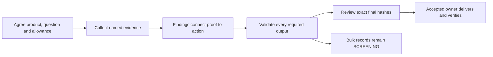

# Engagement tiers and capability routing

Proposed annex UAQG-TIERS 1.0.0 · 16 October 2026 · part of proposed UAQG 1.1.0.
Status: candidate for independent review; not published, adopted or calibrated.

An audit should give its reader a supported decision and an action they can check.
Agree the coverage and delivery format before choosing tools. The three products
below use the [same quality gates](README.md); a smaller allowance changes scope,
not truth, identity, privacy or the meaning of acceptance.

## Product contract, separate from the scoring exam

| Profile ID, version 1.0.0 | Intended decision and required output | Review and boundary |
|---|---|---|
| `paid-full` | Agreed client question, goal, buyer, offer and proof; decision-led summary, evidence inventory, gaps and strengths, conflicts, owned action plan and complete contracted outputs. The personal-brand full product uses its existing 20-page blueprint; when 20 pages are contracted, deliver exactly 20. | Independent content/privacy and visual review of every required final artifact and material judgment. Preserve contracted coverage; do not deliver a free diagnostic in its place. |
| `free-diagnostic` | Explicit narrow question and source window, useful supported findings, coverage/exclusions, unknowns and conditional first actions in the agreed brief format. | Independent review of accepted material judgments and every required final artifact. It cannot claim full-audit coverage. A free PDF still follows the applicable every-human-page visual requirement. |
| `bulk-screening` | Structured per-record identity/evidence fields, coverage, flags, next question and routing; every record receives deterministic schema/mechanical validation. | Review all flagged records plus a reproducibly selected random sample for pipeline quality. Record the population, selection method, seed, selected IDs and reviewed IDs. Sampling never proves every record received independent review. Unreviewed leads remain `SCREENING`; individually checked leads may be `REVIEWED_SCREENING`, never an accepted full audit. |

Freeze `product_profile.id/version`, the contract reference and agreement state,
scope, exclusions, required outputs and checks, human-page count, source window,
goal/buyer, allowed actions, outcome owner and time/cost/iteration allowance.
Defaults in [product-profiles.json](product-profiles.json) are versioned separately
from the [receipt schema](tier-receipt.schema.json). Existing contracted deliverables
continue until their owner authorizes an explicit scope change. An exhausted budget
holds release. A proposed rescope is not accepted scope; record authority and a new
contract before continuing. Do not spend above the allowance to finish.

Keep `specialist_exam` separate: exam ID/version, authoritative source revision and
exam receipt, or null for unscored strategy work. Never infer a rubric from the
product name. [Brand Authority v1.0](../../skills/personal-brand-audit/references/brand-authority-rubric.md),
[specialist acceptance tests](../../skills/personal-brand-audit/references/acceptance-tests.md)
and the [20-page blueprint](../../skills/personal-brand-audit/references/20-page-pdf-blueprint.md)
are the available public contracts at baseline commit
`dcc098bf7d8aa96ff627e4998bed6e406db891d8`. The live method describes Brand
Authority v1.1 while this historical rubric file is v1.0. Pin what was actually
used; do not relabel old work or compare cross-version scores as a trend. The
older handoff's `audit-run-contract.md` path is absent from that public tree;
locate a current authorized source before claiming that contract was read.

## Make the reasoning and action inspectable

Every material finding records evidence IDs and exact locations → interpretation
and uncertainty → consequence for this goal and buyer → proposed action → test.
Keep contrary evidence and UNKNOWN visible. A public self-claim establishes that
the claim is published; it does not independently establish the claimed outcome.

Every action points back to a finding and evidence and names an accountable
function, or an explicitly proposed role awaiting acceptance. Include first step,
dependencies (including an explicit empty list), required authority, actual due date
or proposed timeframe, destination, observable done-when test, and business metric
with source/baseline or UNKNOWN. Proposed ownership, dates and benefits are not
accepted commitments or measured results. No action executes solely because it
appears in an audit. Reuse the existing task and MAA review instead of adding clocks.

## Give each visual a job

For every human-facing PDF page record a semantic visual-function manifest: page,
question answered, meaningful visual kind, source/evidence IDs, caption and exact
render-review evidence. A proof map, annotated recording gallery, demand comparison,
relationship diagram or conflict map should explain that page's finding. Decorative
cards, bars, logo counts, link counts and ordinary text tables do not satisfy the
existing every-human-page meaningful-visual requirement. Retain all-page renders,
rights/provenance and readability checks. The validator can require manifests and
review receipts; it cannot decide whether a diagram teaches something true.

For each link preserve four distinct states with method, evidence and time:
`reachable`, `expected_content`, `recipient_access`, `media_inspected`.
Use PASS/FAIL/UNKNOWN/BLOCKED or justified N/A. HTTP200 is reachability only; a login
page may have the wrong content or be inaccessible to the intended recipient.
oEmbed metadata and thumbnails do not prove media inspection. A recording supporting
a material claim needs inspected content at the cited location, or the claim stays
limited/UNKNOWN and the affected required check holds. Browser playback must be muted
with volume zero; use a bounded transcript or silent inspection when appropriate,
and record what was actually inspected. Do not convert transcript review into video
playback. Never claim all links usable because an availability check passed.

## Route by proven capability and evidence

| Stage | Cheapest capable route | Escalation and receipt |
|---|---|---|
| Retrieval/parsing | Existing authorized read, bounded export, tested parser or validated low-cost worker | Record source access and one successful read/parser check. Missing access requires retrieval or an authorized export, not a stronger model. |
| Arithmetic/schema | Deterministic code | Pin code/schema and input revisions; unknowns stay null. Catch totals, enum and cross-reference errors before model review. |
| Identity/conflicts/synthesis | Reasoning worker proven on the task's evidence and negative cases | Escalate ambiguity, contradictory identity or unsupported claims; preserve uncertainty. A model name alone is not capability evidence. |
| Layout/render | Appropriate renderer plus visual reviewer | Inspect actual final pages/viewports and source-backed figures. Text extraction, image counts and screenshots alone do not certify meaning or rights. |
| Final challenge | Fresh-context independent reviewer with sources and exact final artifacts | Review content/privacy and design; bind each required artifact ID and SHA256. A material change invalidates prior PASS and reruns affected checks. |

Record actual executing app/device, model/effort if surfaced else UNKNOWN, code/tool
revision, capability test evidence, access state and allowance for each routed stage.
Bound attempts, waits and total cost. No universal model ranking, free-plan guarantee,
autonomous uptime promise or paid service requirement is implied. If capability or
budget is insufficient, hold the affected release and give the owner an actionable
retrieval, repair or authorized rescope step.

## Timing and acceptance are evidence, not badges

Separate brief/demo duration, draft generation, QA elapsed time, human minutes,
agent runtime, waits, retries/rework and actual cost/currency. Each measured value
needs its unit, method and evidence; missing values are null/UNKNOWN. Overlapping
durations must not be added as if sequential. A reported stage demo duration does
not measure end-to-end production, checking, export or delivery.

Paid/full and free/diagnostic acceptance composes this annex with existing UAQG
hard gates and the original six report-quality dimensions, weights
25/25/20/15/10/5 and 85 threshold **only with recorded calibration**. Uncalibrated
numbers remain provisional. Do not change scoring to accommodate cheaper work.
The evidence-backed gate is evaluated per artifact, not a generic Reviewed badge.
Bulk screening reports pipeline validation and coverage; it does not claim an
accepted report-quality score or full-population independent review. Promoting a
lead to a diagnostic/full product needs a new explicit profile and exact review.

Use [the JSON contract](tier-receipt.schema.json),
[starter receipt](tier-run-template.json), [existing checker](check_quality.py) and
[examples](tier-examples.md). Mechanical checks validate asserted receipts, not
source truth, reviewer independence or rendered quality. Keep receipts private
when they identify clients, contacts, private sources or operational access.

## Benchmark patterns, with their limitations

The supplied 20-page founder/business audit is a strong design exemplar,
not a certified pass or a new exam. Useful patterns: pages1–2 decision-led proof,
gap and action; page3 assumption-labeled goal-to-market reasoning; page6 ranked
proof; page7 relationship map; page8 inspectable recording gallery; page12
comparable market demand; page15 entity/conflict diagram; page18 owned dated
actions with approvals and done-when tests; page19 contradiction register.

Its page20 says the final v1.1 independent recheck was UNTESTED after a usage cap;
the page19 Reviewed badge must not override that. Page5 pins historical Brand
Authority v1.0 while the maintained method names v1.1. The supplied link receipt's
48/48 reachable does not establish recipient access (two need login) or inspected
media (13 checks use oEmbed metadata). The reported520 links/102 bookmarks are
not quality targets. Test intended destinations, inspectability and section navigation.
Dennis's roughly three-minute on-stage account is reported demo timing; measured
end-to-end production duration is UNKNOWN. Public teaching may use these bounded
lessons; the supplied client benchmark and private receipts are not redistributed.
