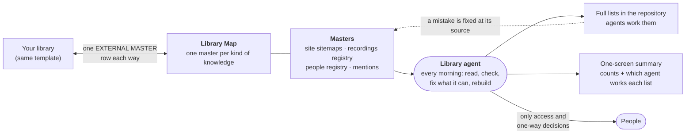

# The content library our agents run

**If you have spent years making videos, articles and friends, you cannot use what you cannot find.** This guide shows how Local Service Spotlight keeps one map of everything it has made. That means videos, calls, web pages, people, proof, talks, photos and how-to steps. Any agent or new teammate can find a piece, add to it and turn it into more content. You can copy the idea for your own business. It takes one sheet, a few plain files and an agent that keeps them up to date.

## Why a map, and not one giant spreadsheet

Our library had grown into one spreadsheet with dozens of tabs that people kept by hand. When we rebuilt it on November 4, 2026, we checked it against the live websites. Of the 6,199 pages listed in the four sites' sitemaps, the hand-kept tabs listed only 44%. Another 242 rows pointed at addresses that were in no sitemap at all. When we opened each one, about half still loaded, mostly through a redirect to a newer page, and the rest were gone. Of the 540 people our records show a real relationship with, 347 had never been named in a page title. And one recurring backup step had quietly fallen weeks behind because only one person ever ran it.

None of that was anyone's fault. It is what happens to any list that people type into. We did not fill in the missing 56%: a hand-kept copy of a sitemap is double work that goes stale the next day. We froze the old tabs as history and let an agent read the sitemaps instead. The library now runs on seven rules, and none of them is ours. Each one comes from a method that already runs large operations:

| # | Rule | Borrowed from |
|---|---|---|
| 1 | **One master per kind of knowledge.** Everything else is a copy a program makes, a frozen piece of history, or a pointer to a master somewhere else. | The [single source of truth](https://en.wikipedia.org/wiki/Single_source_of_truth) in data management |
| 2 | **Derive the list; never keep it by hand.** Pages come from each site's sitemap, people from the relationship registry, counts from formulas. | Lean thinking: extra inventory and extra processing are [waste](https://en.wikipedia.org/wiki/Muda_(Japanese_term)) |
| 3 | **A list earns its place only if someone works it, and if an agent can work it, the agent does.** | Google SRE: [eliminate toil](https://sre.google/sre-book/eliminating-toil/), the manual, repetitive work a machine could do |
| 4 | **People see exceptions, not lists.** The tab people read holds counts and one line per list naming the agent that works it. The rows stay in the repository. The team hears from the agent only when something changed or needs a person. | [Management by exception](https://www.accountingtools.com/articles/what-is-management-by-exception.html) |
| 5 | **One owner per list, named by its function.** Who does it today sits beside the function, so a list never dies when a person leaves. | Amazon's [single-threaded ownership](https://aws.amazon.com/executive-insights/content/amazon-two-pizza-team/) |
| 6 | **Mechanisms, not good intentions.** A schedule, guards that stop the run on bad data, a read-back of every write, and tests for every rule. | Amazon's [mechanisms](https://docs.aws.amazon.com/wellarchitected/latest/operational-readiness-reviews/building-mechanisms.html): a tool, its adoption, and inspection |
| 7 | **Agents decide two-way doors; people decide one-way doors.** A title rename can be undone, so the agent does it and first writes a receipt with the old title. Deleting a page or publishing a private story cannot be undone, so a person decides. | Jeff Bezos's [one-way and two-way doors](https://s2.q4cdn.com/299287126/files/doc_financials/annual/2015-Letter-to-Shareholders.PDF) (Amazon's 2015 letter to shareholders) |

Two house rules follow from all seven. **Fix the source, not the copy:** if a row is wrong, the page, the recording or the registry is wrong; fix it there, and the next run corrects the row. **Private stays private:** a recording, title or quote marked private, a one-on-one session, client data without consent, and every credential stay out of every list people or the public can read. Name the store, never the value.

**Every change an agent makes leaves a receipt.** Before it renames a title, the agent writes a receipt file (one per batch, for example `renames/2026-11-04-titles.json`) with each page's address and ID, the old title, the new title, the date, which agent did it, and how to undo it. Then it reads the page back. The receipt is what makes the change a two-way door. The shape is in the skill's [rename receipt example](../../skills/content-library-keeper/references/rename-receipt-example.json).

### What we stopped doing

- Keeping page lists by hand. The sitemap is the list.
- Handing people long worklists. The summary tab shows counts and owners; the rows stay with the agents.
- Chores on rows in frozen tabs, such as "restore or retire". History stays history.
- The 2021 checklist in which an assistant copied a template and searched five social networks by hand. Its page now redirects to the [public article](https://blitzmetrics.com/content-library/).

## The Library Map

The front door is a sheet tab called *Library Map*. Each row is one kind of knowledge. Each column answers one question an agent would otherwise have to guess:

| Column | The question it answers |
|---|---|
| Kind and Collection | What is this, in plain words? |
| Status | Do I update it here (MASTER), never type in it (LENS), only read it (LEGACY), or go somewhere else (EXTERNAL MASTER)? |
| Where it lives | The exact tab, folder, repository file or site. |
| If two places disagree, this wins | The tiebreaker, written down before anyone needs it. |
| Rows now | A live count (a formula), so a stalled master is visible. |
| Owner: agent function → who today | Which agent does the work: its function first, who does it today second. A person appears only for access or a decision that cannot be undone. |
| Factory stage · Triangle | Where it sits in the Content Factory and which Nine Triangles principle it serves. |
| Freshness | When it was last checked and what was found. |
| Next action | The one thing to do next. |

Ours has 33 rows: the map itself, the rules page, published pages, recordings, the processing ledger, transcripts, phone video, Descript projects, articles on other sites, the publications Dennis wrote for, people, proof, brand assets, photos, methods, sites, clients, audits and the legacy tabs each of those replaced. A starter map with the same columns is in the [content-library-keeper skill](../../skills/content-library-keeper/references/library-map-template.json).

Next to the map sit two working tabs: **Agent Start Here** (the rules, in plain words, and who does what) and **Published Summary** (one screen: pages per site, topics, one line per list with its count and the agent that works it, and the sitemap defects). The rows of every list live in a private repository as CSV files, where the agents read and work them, because a sheet with thousands of rows turns into one more list that somebody types into.

## How work moves through it

The library follows the Content Factory's four locked stages, with setup before and measurement after:

| | What happens | What the library records |
|---|---|---|
| Plumbing (before) | Access, tracking, folders | Where each master lives and who can reach it |
| **Produce** | Record the call, the talk, the phone video | One row per recording in the registry, linked to its file |
| **Process** | Transcribe, edit, clip, write | The Processing Ledger: what is done for each recording and who holds it |
| **Post** | Publish the article, the video, the page | The published inventory, rebuilt from each site's sitemap |
| **Promote** | Boost what works, a dollar a day at a time | Proof, speaking and the pages worth amplifying |
| Perform (after) | Metrics, analysis, action | Each refresh's comparison, and the fixes the agents made |

## Where the Nine Triangles show up

| Triangle | How it shapes the library |
|---|---|
| **SBP** Specialist · Business · Partner | People coverage lists the real relationships nobody has written about yet, so the people who helped us are honored next. |
| **AEC** Audience · Engagement · Conversion | Pages are tagged by topic so the right page can be put in front of the right audience. |
| **GCT** Goals · Content · Targeting | Every list says what it changes, which pages or people it covers, and which agent works it. |
| **MAA** Metrics · Analysis · Action | Each refresh is the metric, the comparison with the last one is the analysis, the agent's fix is the action. |
| **DDD** Do · Delegate · Delete | Every list passes all three: an agent does it, hands it to the agent that can, or the list is deleted. Hand-kept copies are frozen as history, not maintained. |
| **CID** Communicate · Iterate · Delegate | Changes are reported in the project thread after the agent acts; the map is iterated; ownership moves to agents, and a person keeps only access and judgment. |
| **LDT** Learn · Do · Teach | A new agent learns from the map, works one list, then teaches by improving the rules page. |
| **CCS** Content · Checklist · Software | This guide is the content, *Agent Start Here* is the checklist, the inventory scripts are the software. |
| **MOF** Marketing · Operations · Finance | Each owner function sits in one of the three, so no collection belongs to "everyone". |

The names and order follow the [accepted Nine Triangles reference](../../skills/nine-triangles/references/canonical-framework.md); the inventory script tags pages with exactly those names, including the older aliases ACC and ABP.

## What the agent does on each refresh

The refresh is designed to run every morning as a scheduled task.

1. Reads the map and pulls the newest repository copy.
2. Rebuilds the published inventory from every site's sitemap. If any part of a sitemap fails, a site suddenly lists far fewer pages, or a firewall blocks the pages it opens, the run stops, writes nothing and reports why. A partial count never replaces a full one.
3. Compares with yesterday: new pages, pages gone, people newly written about, renames done.
4. Refreshes the summary tab, the map's counts and the map snapshot in the repository, but only what changed. A day with nothing new writes nothing.
5. Checks each master's newest date. A master that stopped growing while its source kept producing is the most important finding of the day.
6. Works its own lists: renames the titles it can edit (writing a receipt with each old title first), hands the rest to the agent that can reach that site, and asks a person only for access or a one-way decision.
7. Commits the generated files, then posts in the team's project thread only when something changed or needs a person. Plain English first; file paths and counts underneath.

## Connect your agents to ours

We are the hub; your library can be a spoke. You keep your own map in the same shape, and each side adds one row that points at the other's shared collection. Nobody writes into the other's masters, and nobody copies them into a third list. Every handoff between agents carries the source and its exact revision, the owner function on each side, the permitted next action, an acceptance test and a stop condition. The full protocol is [hub-and-spoke.md](../../skills/content-library-keeper/references/hub-and-spoke.md), and the general rules for agent handoffs are in [START-HERE.md](../../START-HERE.md).

## Start yours this afternoon

1. List every place your content already lives. Do not move anything yet.
2. Copy the [template map](../../skills/content-library-keeper/references/library-map-template.json) into a sheet tab named *Library Map*.
3. Give each kind of knowledge one row, one master and one owner function.
4. Rename the lists you are replacing with `(legacy)` instead of deleting them, and check any formula that names them.
5. Run the [inventory script](../../skills/content-library-keeper/scripts/published_inventory.py) against your sites' sitemaps.
6. Put only the counts, and one line per list naming the agent that works it, where people look. Keep the rows in a repository, where agents read and work them.
7. Write an *Agent Start Here* tab in plain words.
8. Install the [content-library-keeper skill](../../skills/content-library-keeper/SKILL.md) so any agent you use can run the daily loop.
9. Assign each recurring step to a function, not a person, and give every routine one to an agent. People keep access and judgment.
10. Tell your team where the map is. After that, the agent posts only when something changed or needs a person.

## Related

- Skill: [content-library-keeper](../../skills/content-library-keeper/SKILL.md) (this method, as something an agent can run)
- Skill: [content-factory](../../skills/content-factory/SKILL.md) (turning one recording into many pieces)
- Skill: [positive-mentions-harvester](../../skills/positive-mentions-harvester/SKILL.md) (the proof collection)
- Skill: [second-ring-network-mapper](../../skills/second-ring-network-mapper/SKILL.md) (relationships, from an owner-authorized export)
- Standard: [update the canonical master, never start a silo](../../standards/update-the-canonical-master-never-start-a-silo.md)
- Registry of public masters: [canonical-masters.json](../canonical-masters.json)
- Public article: [Content Library: how agents keep one list of everything you have made](https://blitzmetrics.com/content-library/) (this method in plain words, with the diagram)
- Public article: [Borrowed, Not Invented: the management methods our AI agents run on](https://blitzmetrics.com/borrowed-management-methods/) (where each of the seven rules comes from, and the proven next steps they let us take)
- Framework: [Content Factory](https://blitzmetrics.com/content-factory/) and [Nine Triangles](https://blitzmetrics.com/ntf/)
