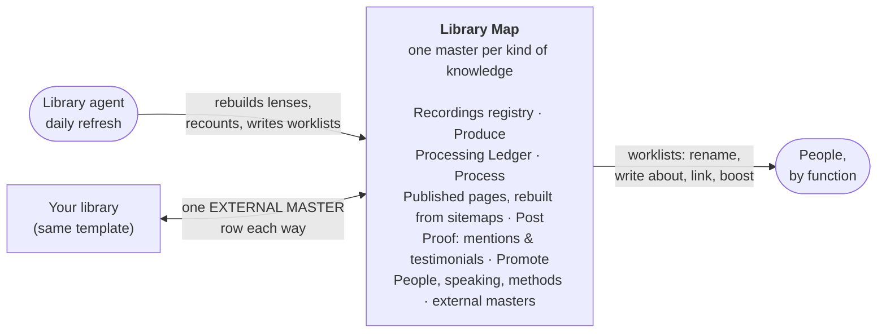

# The content library our agents run

**If you have spent years making videos, articles and friends, you cannot use what you cannot find.** This guide shows how Local Service Spotlight keeps one map of everything it has made. That means recordings, web pages, people, proof, talks, photos and methods. Any agent or new teammate can find a piece, add to it and turn it into more content. You can copy the idea for your own business. It takes one sheet, a few plain files and an agent that checks them every day.

## Why a map, and not one giant spreadsheet

Our library had grown into one spreadsheet with dozens of tabs that people kept by hand. When we rebuilt it on November 4, 2026, we checked it against the live websites. Of the 6,201 pages listed in the four sites' sitemaps, the hand-kept tabs listed only 44%. Another 235 rows pointed at addresses that were in no sitemap at all. When we opened each one, about half still loaded, mostly through a redirect to a newer page, and the rest were gone. Of the 540 people our records show a real relationship with, 348 had never been named in a page title. And one recurring backup step had quietly fallen weeks behind because only one person ever ran it.

None of that was anyone's fault. It is what happens to any list that people type into. So the library now follows four rules:

1. **One master per kind of knowledge.** Everything else is a copy that a program makes, a frozen piece of history, or a pointer to a master somewhere else.
2. **Derive the list, don't maintain it.** The list of published pages comes from each site's sitemap every day. The list of people comes from the relationship registry. Counts are formulas, not typed numbers.
3. **Fix the source, not the copy.** If a row is wrong, the page, the recording or the registry is wrong. Fix it there; the next run corrects the row.
4. **Every collection has an owner function.** "Proof & reputation" owns testimonials; whoever holds that function today does the work. People change roles; functions stay.

## The Library Map

The front door is a sheet tab called *Library Map*. Each row is one kind of knowledge. Each column answers one question an agent would otherwise have to guess:

| Column | The question it answers |
|---|---|
| Kind and Collection | What is this, in plain words? |
| Status | Do I update it here (MASTER), never type in it (LENS), only read it (LEGACY), or go somewhere else (EXTERNAL MASTER)? |
| Where it lives | The exact tab, folder, repository file or site. |
| If two places disagree, this wins | The tiebreaker, written down before anyone needs it. |
| Rows now | A live count (a formula), so a stalled master is visible. |
| Owner: function → who today | Who does the work, by role first and name second. |
| Factory stage · Triangle | Where it sits in the Content Factory and which Nine Triangles principle it serves. |
| Freshness | When it was last checked and what was found. |
| Next action | The one thing to do next. |

Ours has 33 rows: the map itself, the rules page, published pages, recordings, the processing ledger, transcripts, phone video, Descript projects, articles on other sites, the publications Dennis wrote for, people, proof, brand assets, photos, methods, sites, clients, audits and the legacy tabs each of those replaced. A starter map with the same columns is in the [content-library-keeper skill](../../skills/content-library-keeper/references/library-map-template.json).

Next to the map sit two working tabs: **Agent Start Here** (the rules, in plain words) and **Published Summary & Worklists** (counts per site and the short lists people act on: titles to rename, people we have never written about, old rows whose address is in no sitemap, with what each one does today, and sitemap defects). The full list of every page lives in a private repository as a CSV, because a sheet with thousands of rows turns into one more list that somebody types into.

## How work moves through it

The library follows the Content Factory's four locked stages, with setup before and measurement after:

| | What happens | What the library records |
|---|---|---|
| Plumbing (before) | Access, tracking, folders | Where each master lives and who can reach it |
| **Produce** | Record the call, the talk, the phone video | One row per recording in the registry, linked to its file |
| **Process** | Transcribe, edit, clip, write | The Processing Ledger: what is done for each recording and who holds it |
| **Post** | Publish the article, the video, the page | The published inventory, rebuilt from each site's sitemap |
| **Promote** | Boost what works, a dollar a day at a time | Proof, speaking and the pages worth amplifying |
| Perform (after) | Metrics, analysis, action | The daily comparison and the worklists |

## Where the Nine Triangles show up

| Triangle | How it shapes the library |
|---|---|
| **SBP** Specialist · Business · Partner | People coverage lists the real relationships nobody has written about yet, so the people who helped us are honored next. |
| **AEC** Audience · Engagement · Conversion | Pages are tagged by topic so the right page can be put in front of the right audience. |
| **GCT** Goals · Content · Targeting | Every worklist says what it changes, which pages or people it covers, and who acts. |
| **MAA** Metrics · Analysis · Action | The daily run is the metric, the comparison with yesterday is the analysis, the worklist is the action. |
| **DDD** Do · Delegate · Delete | Duplicate lists are frozen as legacy, collections are delegated to functions, and the agent does the daily checking. |
| **CID** Communicate · Iterate · Delegate | Changes are reported in the project thread; the map is iterated; ownership moves progressively. |
| **LDT** Learn · Do · Teach | A new agent learns from the map, does one worklist, then teaches by improving the rules page. |
| **CCS** Content · Checklist · Software | This guide is the content, *Agent Start Here* is the checklist, the inventory scripts are the software. |
| **MOF** Marketing · Operations · Finance | Each owner function sits in one of the three, so no collection belongs to "everyone". |

The names and order follow the [accepted Nine Triangles reference](../../skills/nine-triangles/references/canonical-framework.md); the inventory script tags pages with exactly those names, including the older aliases ACC and ABP.

## What the agent does every day

1. Reads the map and pulls the newest repository copy.
2. Rebuilds the published inventory from every site's sitemap. If any part of a sitemap fails, or a site suddenly lists far fewer pages, the run stops, writes nothing and reports why. A partial count never replaces a full one.
3. Compares with yesterday: new pages, pages gone, people newly written about, renames done.
4. Refreshes the summary tab, the map's counts and the map snapshot in the repository, but only what changed. A day with nothing new writes nothing.
5. Checks each master's newest date. A master that stopped growing while its source kept producing is the most important finding of the day.
6. Commits the generated files, then posts in the team's project thread only when something changed or needs a person. Plain English first; file paths and counts underneath.

## Connect your agents to ours

We are the hub; your library can be a spoke. You keep your own map in the same shape, and each side adds one row that points at the other's shared collection. Nobody writes into the other's masters, and nobody copies them into a third list. Every handoff between agents carries the source and its exact revision, the owner function on each side, the permitted next action, an acceptance test and a stop condition. The full protocol is [hub-and-spoke.md](../../skills/content-library-keeper/references/hub-and-spoke.md), and the general rules for agent handoffs are in [START-HERE.md](../../START-HERE.md).

## Start yours this afternoon

1. List every place your content already lives. Do not move anything yet.
2. Copy the [template map](../../skills/content-library-keeper/references/library-map-template.json) into a sheet tab named *Library Map*.
3. Give each kind of knowledge one row, one master and one owner function.
4. Rename the lists you are replacing with `(legacy)` instead of deleting them, and check any formula that names them.
5. Run the [inventory script](../../skills/content-library-keeper/scripts/published_inventory.py) against your sites' sitemaps.
6. Put the counts and the short worklists where people look; keep the full list in a repository.
7. Write an *Agent Start Here* tab in plain words.
8. Install the [content-library-keeper skill](../../skills/content-library-keeper/SKILL.md) so any agent you use can run the daily loop.
9. Assign each recurring step to a function, not a person.
10. Tell your team where the map is, and post the first worklist.

## Related

- Skill: [content-library-keeper](../../skills/content-library-keeper/SKILL.md) (this method, as something an agent can run)
- Skill: [content-factory](../../skills/content-factory/SKILL.md) (turning one recording into many pieces)
- Skill: [positive-mentions-harvester](../../skills/positive-mentions-harvester/SKILL.md) (the proof collection)
- Skill: [second-ring-network-mapper](../../skills/second-ring-network-mapper/SKILL.md) (relationships, from an owner-authorized export)
- Standard: [update the canonical master, never start a silo](../../standards/update-the-canonical-master-never-start-a-silo.md)
- Registry of public masters: [canonical-masters.json](../canonical-masters.json)
- Framework: [Content Factory](https://blitzmetrics.com/content-factory/) and [Nine Triangles](https://blitzmetrics.com/nine-triangles/)
